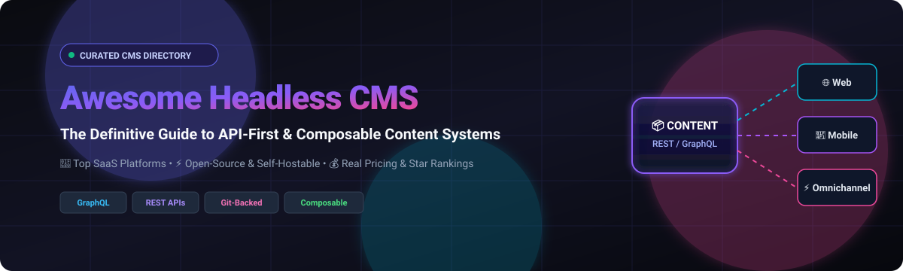

# 🚀 Awesome Headless CMS

  

  
  
  
  
  
  

<h3 align="center">
  🌟 Curated List of Headless CMS Platforms, API-First Content Engines & Open-Source Repositories
</h3>

  <strong>Comprehensive guide to API-First Content Management, Omnichannel Content Delivery, Composable DXP & Developer Experience.</strong>
   
  <em>Last updated: August 2026</em>

---

## 📖 Overview & Ecosystem Guide

This repository tracks notable **SaaS/hosted platforms** and **open-source projects** for Headless Content Management Systems (CMS). These platforms separate content management from presentation, exposing content through APIs (GraphQL, REST, or SDKs) so it can be delivered seamlessly to websites, mobile applications, e-commerce storefronts, digital signage, IoT devices, and documentation hubs.

* **🎯 Core Categories**: API-First Headless CMS, Visual Page Builders, Composable Content Platforms, Git-backed CMSs, and Enterprise DXPs.
* **🌐 Key Protocols**: GraphQL, REST API, JSON:API, SDKs, and Webhooks.
* **⚡ Modern Frontends**: Next.js, Nuxt, Astro, SvelteKit, Remix, Gatsby, iOS, Android, and Flutter.

---

## 📑 Table of Contents

- [☁️ SaaS & Hosted Platforms](#️-saashosted-platforms)
- [💻 Open-Source GitHub Projects](#-open-source-github-projects)
- [🧱 Open-Source Building Blocks](#-open-source-building-blocks)
- [📊 Star History](#-star-history)
- [🤝 How to Contribute](#-how-to-contribute)
- [⚖️ Disclaimer](#️-disclaimer)

---

## ☁️ SaaS/Hosted Platforms

> 💡 **Market Outlook & Structure (2026)**: The global headless CMS market is estimated at **~$1.82B – $2.0B in 2026** (growing at a rapid **~18–22% CAGR**). The sector exhibits **moderate market concentration**—the top tier of vendors (Contentful, Sanity, Contentstack, Storyblok, Kontent.ai) accounts for ~50–55% of global market share, while a vibrant, highly dynamic long tail of niche and specialized API-first providers fuels ongoing composable ecosystem innovation.

The table below is sorted in descending order by estimated company valuation / scale / revenue:

| Platform | Valuation / Company Scale | Description | Pricing | Free Tier Limits |
| :--- | :--- | :--- | :--- | :--- |
| **[Contentful](https://www.contentful.com/)** | **~$3.0B Valuation** (~$210M ARR) | Enterprise-focused composable/headless CMS providing structured content models, APIs, localization, workflows, and omnichannel delivery. | From **$300/month** (Lite Plan) | **Free forever**: 1 Starter space, 10 users, 2 locales, 25 content models, 100k API calls/mo, 50 GB asset bandwidth/mo. |
| **[Contentstack](https://www.contentstack.com/)** | **~$750M Valuation** (~$120M ARR) | Enterprise composable DXP/headless CMS supporting structured content, workflows, localization, integrations, and omnichannel delivery. | From **$995–$3,500/month** (Contract-based) | **Free Developer / Explorer Account** for evaluation; custom-length free trial available upon request. |
| **[Builder.io](https://www.builder.io/)** | **~$200M Valuation** (~$37M funding) | Visual headless CMS and digital experience platform combining structured content with visual page building and frontends. | From **$24/user/month** (Pro Plan) | **Free forever**: Up to 5 users per space, 75 monthly Agent Credits (25/day limit); **14-day free trial** of Pro. |
| **[Sanity](https://www.sanity.io/)** | **~$173M Funding** (~$40M+ ARR) | Developer-focused content platform built around a real-time Content Lake and customizable Studio, with GROQ and GraphQL APIs. | From **$15/seat/month** (Growth Plan) | **Free forever**: 20 seats, 2 datasets, 10k documents, 1M API requests/mo, 5M API CDN requests/mo, 100 GB storage, 100 GB bandwidth. |
| **[Hygraph](https://hygraph.com/)** | **~$143M Valuation** (~$45M funding) | GraphQL-native headless CMS supporting structured content, content federation, localization, and composable digital experiences. | From **$199/month** (Growth Plan) | **Free forever** (Hobby): 3 seats, 2 roles, 2 locales, 10 components, 500k API calls/mo, 50 MB max file size, 5 RPS; **30-day free trial**. |
| **[Storyblok](https://www.storyblok.com/)** | **~$138M Funding** (~$80M ARR) | Headless CMS combining structured content APIs with a visual editor, component-based page building, collaboration, and localization. | From **$99/month** (Growth Plan) | **Free forever**: 1 space, 1 seat, 2 locales/languages, 100k API requests/mo, 100 GB traffic/mo; **14-day free trial** for paid plans. |
| **[Kontent.ai](https://kontent.ai/)** | **~$40M Funding** (~$16M ARR) | Enterprise headless CMS for structured content, omnichannel delivery, localization, workflows, and composable architectures. | From **Custom / Quote-based (~$1,000+/mo)** | **30-day free trial** with full enterprise platform access & AI credits; Developer Plan: 1 user, 2 languages, 200k API calls/mo. |
| **[Prismic](https://prismic.io/)** | **~$20M Funding** (~$15M ARR) | Headless CMS focused on structured content, reusable slices, visual page building, localization, and developer-friendly integrations. | From **$10/month** (Starter Plan) | **Free forever**: 1 user, 2 locales, 4M API calls/mo, 100 GB CDN bandwidth/mo, visual page builder included. |
| **[Strapi Cloud](https://strapi.io/cloud)** | **~$49M Funding** (~$10M ARR) | Managed cloud hosting for Strapi projects, providing cloud infrastructure and deployment while retaining the Strapi application model. | From **$29/month** (Starter Plan) | **No free tier / No free trial** (Community Edition self-hosted is open source; Cloud is paid subscription only). |
| **[Directus Cloud](https://directus.io/pricing)** | **~$7M Funding** (Venture-backed) | Data-first content and data platform providing APIs and an administration interface over SQL databases. | From **$499/month** (Team Plan) | **Free forever** (Core): 3 seats, 25 collections, 5 flows, AI Assistant, RBAC (also free self-hosted open-source). |
| **[Payload Cloud](https://payloadcms.com/)** | **Acquired by Figma** (~$3M ARR pre-acq) | Managed cloud hosting platform for TypeScript-first Payload CMS and application framework. | From **$35/month** (Standard Plan) | **Open-source self-hosted is 100% free** (no seat/record limits); Cloud sign-ups paused post-Figma acquisition. |
| **[ButterCMS](https://buttercms.com/)** | **Bootstrapped** (~$2.5M ARR) | Hosted headless CMS with APIs and prebuilt content functionality for blogs, pages, collections, and marketing content. | From **$71/month** (Micro Plan) | **Free forever**: 5 pages, 50 blog posts, 50k API calls/mo, 100 GB bandwidth/mo, unlimited users; **14-day free trial**. |
| **[Agility CMS](https://agilitycms.com/)** | **Bootstrapped** (~$2.9M ARR) | Hybrid/headless CMS providing structured content, page management, content modeling, APIs, and visual editing capabilities. | From **$699/month** (Essentials Plan) | **30-day free trial** with full platform access (no credit card required); Proof-of-Concept tier: 5 users, 25,000 entries. |
| **[Cosmic](https://www.cosmicjs.com/)** | **Bootstrapped** (~$1.2M ARR) | API-first hosted CMS focused on structured content, content models, media, and developer-oriented integrations. | From **$49/month** (Builder Plan) | **Free forever**: 2 team members, 1,000 objects, 10,000 non-cached API requests/mo, 1 GB media storage, 1 GB bandwidth. |
| **[DatoCMS](https://www.datocms.com/)** | **Bootstrapped** (~$1.3M ARR) | API-first content platform designed for structured content, publishing workflows, localization, media management, and fast sites. | From **€149/month** (Professional Plan) | **Free forever** (Developer): 2 editors, 300 records, 3 projects, 3 sandbox environments, 100k API calls/mo, 10 GB traffic/mo. |
| **[Zesty.io](https://www.zesty.io/)** | **Bootstrapped** (~$650k ARR) | Enterprise content platform supporting headless and traditional web publishing, structured content, and localization. | From **$475/month** (Start Up Plan) | **Free forever** (Community): 1 user, 5 GB storage, 5 GB CDN bandwidth, 50,000 CDN requests, 3,000 API calls/mo. |

---

## 💻 Open-Source GitHub Projects

The following list contains open-source and source-available Headless CMS platforms and decoupled content frameworks, sorted in **descending order by GitHub Star count**:

1. **[Strapi](https://github.com/strapi/strapi)** 
   * *Language / Stack*: TypeScript / Node.js
   * *Description*: One of the most popular and mature open-source headless CMS platforms. Features an intuitive admin panel, customizable content-types, RBAC, REST and GraphQL APIs.

2. **[PocketBase](https://github.com/pocketbase/pocketbase)** 
   * *Language / Stack*: Go / SQLite
   * *Description*: Open-source single-binary backend with embedded SQLite database, realtime subscriptions, built-in auth, file storage, and an elegant admin UI.

3. **[Ghost](https://github.com/TryGhost/Ghost)** 
   * *Language / Stack*: JavaScript / Node.js
   * *Description*: Modern publishing platform with a rich editorial experience and a high-performance Content API, widely used for headless blogs and editorial sites.

4. **[Payload CMS](https://github.com/payloadcms/payload)** 
   * *Language / Stack*: TypeScript / Next.js / Node.js
   * *Description*: Code-first TypeScript headless CMS and full-stack application framework with native Next.js integration, REST/GraphQL APIs, and extensible React admin UI.

5. **[Directus](https://github.com/directus/directus)** 
   * *Language / Stack*: TypeScript / Vue.js / Node.js
   * *Description*: Data engine and API platform that dynamically overlays SQL databases with instant REST and GraphQL APIs, customizable admin app, flows, and auth.

6. **[WordPress](https://github.com/WordPress/WordPress)** 
   * *Language / Stack*: PHP / MySQL
   * *Description*: The web's ubiquitous CMS platform, functioning seamlessly in headless/decoupled architectures via its native REST API and WPGraphQL.

7. **[Wagtail](https://github.com/wagtail/wagtail)** 
   * *Language / Stack*: Python / Django
   * *Description*: Powerful open-source Django content management system with flexible streamfields, customizable editorial workflow, and built-in headless API endpoints.

8. **[Decap CMS](https://github.com/decaporg/decap-cms)** 
   * *Language / Stack*: JavaScript / React
   * *Description*: Open-source Git-backed CMS (formerly Netlify CMS) for single-page React applications, editing Markdown, YAML, and JSON stored in Git.

9. **[TinaCMS](https://github.com/tinacms/tinacms)** 
   * *Language / Stack*: TypeScript / React
   * *Description*: Open-source Git-backed headless CMS enabling real-time visual editing for Markdown, MDX, and JSON stored directly in your GitHub repository.

10. **[October CMS](https://github.com/octobercms/october)** 
    * *Language / Stack*: PHP / Laravel
    * *Description*: Self-hosted content management system and framework based on Laravel, capable of powering decoupled and REST/GraphQL-backed frontend apps.

11. **[KeystoneJS](https://github.com/keystonejs/keystone)** 
    * *Language / Stack*: TypeScript / Node.js
    * *Description*: Powerful GraphQL-first headless CMS and web application framework with declarative schema definition, access control, and auto-generated admin UI.

12. **[Webiny](https://github.com/webiny/webiny-js)** 
    * *Language / Stack*: TypeScript / Serverless (AWS)
    * *Description*: Open-source enterprise serverless CMS designed to run on AWS Lambda and DynamoDB/Elasticsearch, offering page building, form builders, and GraphQL APIs.

13. **[Publii](https://github.com/GetPublii/Publii)** 
    * *Language / Stack*: JavaScript / Electron
    * *Description*: Desktop-based CMS application for creating static, fast, and secure websites deployed directly to Netlify, GitHub Pages, AWS S3, or standard servers.

14. **[Joomla](https://github.com/joomla/joomla-cms)** 
    * *Language / Stack*: PHP / MySQL
    * *Description*: Established open-source CMS with built-in Web Services (REST APIs) for headless content delivery across web and mobile endpoints.

15. **[Statamic](https://github.com/statamic/cms)** 
    * *Language / Stack*: PHP / Laravel
    * *Description*: Flat-first CMS powered by Laravel, supporting Markdown files, Git-based version control, and native GraphQL and REST APIs.

16. **[ApostropheCMS](https://github.com/apostrophecms/apostrophe)** 
    * *Language / Stack*: JavaScript / Node.js
    * *Description*: Full-featured Node.js CMS framework supporting in-context on-page editing, REST APIs, localized content trees, and headless microservices.

17. **[Drupal](https://github.com/drupal/drupal)** 
    * *Language / Stack*: PHP / Symfony
    * *Description*: Enterprise-grade decoupled CMS featuring JSON:API, GraphQL, complex workflows, content modeling, multilingual support, and robust permissions.

18. **[Pimcore](https://github.com/pimcore/pimcore)** 
    * *Language / Stack*: PHP / Symfony
    * *Description*: Enterprise Open Source platform consolidating CMS, PIM (Product Information Management), DAM (Digital Asset Management), and commerce via headless Data Hub APIs.

19. **[Craft CMS](https://github.com/craftcms/cms)** 
    * *Language / Stack*: PHP / Yii
    * *Description*: Flexible content management system focused on structured content, custom matrix fields, live preview, and native GraphQL API for decoupled frontends.

20. **[Outstatic](https://github.com/avitorio/outstatic)** 
    * *Language / Stack*: TypeScript / Next.js
    * *Description*: Static CMS framework for Next.js that uses GitHub as its database and storage provider, providing an instant admin dashboard in your app.

21. **[Sveltia CMS](https://github.com/sveltia/sveltia-cms)** 
    * *Language / Stack*: TypeScript / Svelte
    * *Description*: Modern, lightweight Git-backed CMS built with Svelte as an ultra-fast, drop-in replacement for Netlify CMS and Decap CMS.

22. **[Squidex](https://github.com/Squidex/squidex)** 
    * *Language / Stack*: C# / .NET Core / MongoDB
    * *Description*: Open-source Headless CMS with structured content modeling, REST and GraphQL APIs, workflows, localization, asset management, and cloud-native clustering.

23. **[Keystatic](https://github.com/Thinkmill/keystatic)** 
    * *Language / Stack*: TypeScript / React
    * *Description*: Code-first content management tool by Thinkmill that writes structured content (JSON, YAML, Markdoc) directly to your local file system or GitHub repository.

24. **[Daptin](https://github.com/daptin/daptin)** 
    * *Language / Stack*: Go
    * *Description*: Multi-database backend and JSON:API / GraphQL engine providing instant CRUD APIs, user management, OAuth integrations, and state machine workflows.

25. **[ProcessWire](https://github.com/processwire/processwire)** 
    * *Language / Stack*: PHP
    * *Description*: Highly flexible open-source PHP content management system and framework with jQuery-inspired API and strong support for headless delivery.

26. **[Backdrop CMS](https://github.com/backdrop/backdrop)** 
    * *Language / Stack*: PHP / MySQL
    * *Description*: Lightweight open-source CMS forked from Drupal 7, designed for small-to-medium businesses and custom API integrations.

27. **[dotCMS](https://github.com/dotCMS/core)** 
    * *Language / Stack*: Java / React
    * *Description*: Hybrid enterprise open-source CMS providing GraphQL APIs, RESTful endpoints, visual page composition, and microservices architecture.

28. **[Concrete CMS](https://github.com/concretecms/concretecms)** 
    * *Language / Stack*: PHP
    * *Description*: Open-source content management system featuring in-context editing and REST API capabilities for headless web development.

29. **[Superdesk](https://github.com/superdesk/superdesk)** 
    * *Language / Stack*: Python / AngularJS
    * *Description*: Open-source newsroom management system and publishing platform created for news organizations with high-volume collaborative workflows.

30. **[Cockpit](https://github.com/Cockpit-HQ/Cockpit)** 
    * *Language / Stack*: PHP / SQLite / MongoDB
    * *Description*: Lightweight, API-first headless CMS designed for managing structured content collections, assets, and delivering them via REST APIs.

31. **[Flextype](https://github.com/flextype/flextype)** 
    * *Language / Stack*: PHP
    * *Description*: Open-source flat-file content management system with REST APIs, built for speed, simplicity, and flexibility without requiring a database.

32. **[Silverstripe CMS](https://github.com/silverstripe/silverstripe-cms)** 
    * *Language / Stack*: PHP / Silverstripe Framework
    * *Description*: Flexible open-source CMS engine with an intuitive authoring UI and GraphQL module for decoupled headless websites.

33. **[BCMS](https://github.com/bcms/cms)** 
    * *Language / Stack*: TypeScript / Node.js / Vue.js
    * *Description*: Open-source, self-hostable headless CMS built for developers and content creators with instant schema building, webhooks, and code generators.

34. **[Frappe Wiki](https://github.com/frappe/wiki)** 
    * *Language / Stack*: Python / Frappe Framework
    * *Description*: Free and open-source headless wiki and documentation engine built on top of the extensible Frappe framework.

35. **[Plone](https://github.com/plone/Products.CMFPlone)** 
    * *Language / Stack*: Python / Zope / React (Volto)
    * *Description*: Enterprise-grade CMS with powerful security, fine-grained access control, and a full REST API for headless content delivery.

36. **[Contember](https://github.com/contember/contember)** 
    * *Language / Stack*: TypeScript / GraphQL / PostgreSQL
    * *Description*: Declarative open-source platform for defining schema, permissions, and generating customized admin UIs with GraphQL APIs over PostgreSQL.

---

## 🧱 Open-Source Building Blocks

When architecting a tailored, self-hosted, or composable headless CMS stack, developers commonly combine the following open-source building blocks:

| Layer | Open-Source Options | Purpose |
| :--- | :--- | :--- |
| **Headless CMS Engine** | Strapi, Payload CMS, KeystoneJS, Squidex, Outstatic | Core content modelling, schema definitions, and editorial admin UI |
| **Database-First CMS** | Directus, Contember, PocketBase | Expose structured SQL/NoSQL database tables via instant APIs |
| **Git-Based CMS** | TinaCMS, Keystatic, Sveltia CMS, Decap CMS | Version-controlled content stored directly in Git (Markdown, MDX, JSON) |
| **Publishing / Decoupled CMS** | Ghost, WordPress, Drupal, Wagtail | Editorial publishing, authoring workflows, and decoupled REST/GraphQL backends |
| **Enterprise DXP & PIM** | Pimcore, Plone, dotCMS | Complex multi-channel product information and digital asset management |
| **Serverless CMS** | Webiny | Cloud-native, zero-maintenance serverless content backend on AWS |
| **API & Delivery Layer** | REST APIs, GraphQL, tRPC, Webhooks | Omni-channel content delivery to web, mobile, IoT, and applications |
| **Relational & Document DBs** | PostgreSQL, MySQL, SQLite, MongoDB | Resilient content persistence and indexing |
| **Authentication & IAM** | Keycloak, Authentik, Ory Kratos | Enterprise SSO, OIDC, OAuth2, and granular role-based permissions (RBAC) |
| **Full-Text & Vector Search** | OpenSearch, Meilisearch, Typesense | Fast search autocomplete, faceted filtering, and content discovery |
| **Object & Asset Storage** | MinIO, SeaweedFS | High-throughput storage for media, images, video assets, and backups |
| **Edge CDN & Caching** | Cloudflare, NGINX, Varnish | Global edge caching, low-latency API proxying, and DDoS mitigation |
| **Orchestration & Workflow** | Temporal, n8n, Node-RED | Automated publishing pipelines, webhook processing, and ETL workflows |
| **Frontend Frameworks** | Next.js, Nuxt, Astro, SvelteKit, Remix | Modern decoupled presentation layer and Static Site Generation (SSG/SSR) |
| **Privacy-First Analytics** | Matomo, Umami, Plausible | GDPR-compliant content engagement and website traffic analytics |
| **Observability & Telemetry** | OpenTelemetry, Prometheus, Grafana | Distributed API tracing, latency metrics, and server performance monitoring |
| **Localization & Translation** | Weblate | Open-source continuous localization and internationalization pipelines |

---

## 📊 Star History

---

## 🤝 How to Contribute

Contributions are warmly welcomed! Help keep this curated directory the best resource on the web:

1. **Fork the repo** on GitHub.
2. **Add or edit entries** in `README.md` ensuring accurate links, correct categorization, and transparent pricing/star metadata.
3. For open-source projects, link directly to the **canonical GitHub repository** and include stack information.
4. For SaaS tools, provide accurate starting prices and exact free tier/trial limits.
5. **Submit a Pull Request (PR)** with a clear title and summary of changes.
6. ⭐️ **Star the repository** if you find it valuable!

---

## ⚖️ Disclaimer

* This repository is a community-curated directory intended for educational, architectural, and developer reference.
* The term **Headless CMS** encompasses a wide variety of architectures including API-first cloud services, Git-backed markdown tools, self-hosted database engines, and traditional CMSs operating in decoupled mode.
* Software licensing models (MIT, Apache 2.0, BSL, SSPL, Commercial) change over time—always verify current licensing and terms before deploying to production environments.
* Made with ❤️ for developers, digital agencies, product architects, and engineering teams building composable digital experiences.
